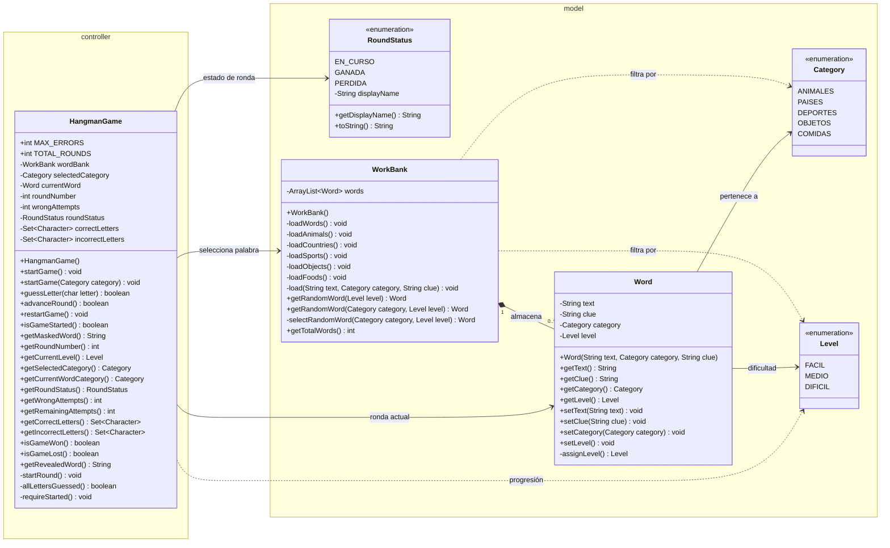

# hangman

## Descripción del proyecto

**Juego del Ahorcado Interactivo** es una aplicación desarrollada en Java como proyecto final de la asignatura **Programación Orientada a Objetos (POO)** de la Universidad EAN por los integrantes:
- Lizeth Nathalia Lozano
- María Lucía Ovalle
- Nury Natalia Toro
- Jhon Janier Vera

---

## 📌 Características principales

- Banco de **200 palabras**.
- Mínimo **5 categorías**:
  - Animales.
  - Países.
  - Deportes.
  - Objetos.
  - Comidas.
- Selección aleatoria de palabras.
- Máximo de **7 intentos fallidos**.
- Registro de letras correctas e incorrectas.
- Representación gráfica progresiva del ahorcado.
- Tres tipos de pistas:
  1. Categoría de la palabra.
  2. Revelar una letra aleatoria.
  3. Pista escrita relacionada con la palabra.
- Interfaz gráfica desarrollada con **Java Swing**.
- Aplicación de encapsulación, herencia y polimorfismo.
- Manejo de información mediante `ArrayList`.

---

# 📐 Diagramas UML

## Diagrama de casos de uso

El siguiente diagrama representa las principales acciones que puede realizar el jugador dentro de la aplicación.


```text
docs/use-case-diagram.png
```

---

## Diagrama de clases

El diagrama UML **actualizado según las clases implementadas** puede editarse en [`hangman/docs/class-diagram.md`](hangman/docs/class-diagram.md). Muestra los paquetes `model` y `controller`, incluyendo el constructor único de `HangmanGame`, los métodos `startGame()`, la enumeración `RoundStatus` en español y la sobrecarga de `getRandomWord()`.



> El PNG anterior (`hangman/src/main/java/docs/class-diagram.png`) se conserva como referencia histórica, pero la versión vigente y editable es el diagrama Mermaid anterior.

Las clases, atributos y métodos del proyecto se encuentran nombrados en **inglés**, de acuerdo con la convención utilizada durante el desarrollo.

---

# 🛠️ Requisitos

Para compilar y ejecutar el proyecto se requiere:

- **Java JDK 17** o una versión compatible.
- Un IDE para Java, por ejemplo:
  - IntelliJ IDEA
  - Eclipse
  - Apache NetBeans

Para comprobar la versión instalada de Java:

```bash
java -version
```

Para comprobar la versión del compilador:

```bash
javac -version
```

---

# 📁 Estructura del proyecto

```text
InteractiveHangmanGame/
│
├── src/
│   └── ...
│
├── test/
│   └── ...
│
├── docs/
│   ├── use-case-diagram.png
│   ├── class-diagram.png
│   └── ManualUsuario.pdf
│
└── README.md
```

La estructura podrá ajustarse según los paquetes utilizados durante el desarrollo.

---

# ⚙️ Compilación

## Desde un IDE

1. Abrir el proyecto en el IDE seleccionado.
2. Verificar que el proyecto utilice una versión compatible del JDK.
3. Compilar el proyecto.
4. Verificar que no se presenten errores de compilación.

---

## Desde la terminal

Ubicarse en la carpeta raíz del proyecto.

Compilar los archivos Java:

```bash
javac -d out src/*.java
```

Los archivos compilados serán almacenados en la carpeta:

```text
out/
```

> Este comando deberá ajustarse si el proyecto utiliza paquetes Java.

---

# ▶️ Ejecución

## Desde el IDE

Ejecutar la clase:

```java
Main
```

que contiene el método:

```java
public static void main(String[] args)
```

---

## Desde la terminal

Después de compilar el proyecto:

```bash
java -cp out Main
```

Si se utilizan paquetes, el comando deberá incluir el nombre completo del paquete correspondiente a la clase `Main`.

---

# 🧪 Pruebas

Antes de realizar la entrega se deben verificar, como mínimo, los siguientes escenarios:

### Inicio del juego

- La aplicación inicia correctamente.
- Se selecciona una palabra aleatoria.
- La palabra aparece inicialmente oculta.
- El contador de errores inicia en cero.

### Letras correctas

- Una letra correcta aparece en la posición correspondiente.
- Si una letra aparece varias veces, se revelan todas sus posiciones.
- Una letra correcta no aumenta el número de errores.

### Letras incorrectas

- La letra queda registrada como incorrecta.
- Se incrementa el número de errores.
- El dibujo del ahorcado se actualiza.

### Letras repetidas

- Una letra previamente seleccionada no debe contabilizarse nuevamente como error o acierto.

### Pistas

Verificar el funcionamiento de:

- Pista de categoría.
- Revelación de una letra.
- Pista escrita.

Cada pista debe comportarse según las reglas definidas para la partida.

### Victoria

- Al completar todas las letras de la palabra se muestra el mensaje correspondiente.
- El juego identifica correctamente la partida como ganada.

### Derrota

- Al alcanzar los **7 intentos fallidos** se completa el ahorcado.
- Se muestra el mensaje de derrota.
- Se muestra la palabra correcta.

### Nueva partida

- Se reinician los intentos.
- Se limpian las letras utilizadas.
- Se restablecen las pistas.
- Se selecciona una nueva palabra.

---

# 🧪 Ejecución de pruebas automatizadas

El proyecto utiliza **Maven**, **Java 17** y **JUnit 5**. Los archivos de pruebas unitarias actuales se encuentran en:

```text
hangman/src/test/java/com/poo/hangman/model/
├── WordTest.java
└── WorkBankTest.java
```

> Nota: la clase del banco de palabras se llama `WorkBank` (con **k** después de `Wor`), por lo que su prueba se llama `WorkBankTest`.

## Desde Apache NetBeans

1. Abrir como proyecto Maven la carpeta `hangman/`, que contiene el archivo `pom.xml`.
2. En el panel **Projects**, expandir **Test Packages → com.poo.hangman.model** o **com.poo.hangman.controller**.
3. Para ejecutar una sola clase de pruebas, hacer clic derecho en `WordTest.java`, `WorkBankTest.java` o `HangmanGameTest.java` y seleccionar **Test File**.
4. Para ejecutar todas las pruebas, hacer clic derecho sobre el proyecto y seleccionar **Test** o **Test Project**.
5. Revisar los resultados en **Test Results** y en la ventana **Output**.

## Desde la terminal con Maven

Abrir una terminal en la carpeta `hangman/` donde está `pom.xml` (no en la raíz exterior del repositorio).

**Ejecutar todas las pruebas:**

```bash
mvn test
```

**Ejecutar únicamente las pruebas de la clase Word:**

```bash
mvn -Dtest=WordTest test
```

**Ejecutar únicamente las pruebas de la clase WorkBank:**

```bash
mvn -Dtest=WorkBankTest test
```

**Ejecutar únicamente las pruebas de HangmanGame:**\n\n```bash\nmvn -Dtest=HangmanGameTest test\n```\n\n**Interpretar los resultados:** `BUILD SUCCESS` indica que Maven terminó correctamente; revisar también el número de pruebas ejecutadas y los valores `Failures` y `Errors`. Si aparece `BUILD FAILURE`, consultar el detalle de la prueba o error de compilación en `Output`.

## Sincronización de la rama de desarrollo

Si el proyecto ya está clonado y no hay cambios locales sin guardar, actualizar las pruebas y el código de la rama de trabajo:

```bash
git fetch origin
git switch nunatogo-desa
git pull --ff-only origin nunatogo-desa
```

No ejecutar `git switch` si hay cambios locales que podrían sobrescribirse; guardarlos o revisarlos antes.

---

El enlace también estará incluido en el **Manual de Usuario**, de acuerdo con los requerimientos de la entrega.
