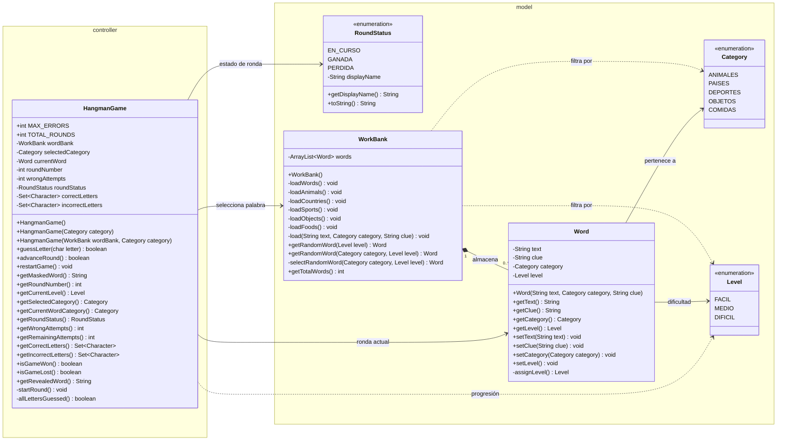

# Diagrama de clases UML — estado implementado

Diagrama actualizado con las clases Java existentes en los paquetes `com.poo.hangman.model` y `com.poo.hangman.controller` de la rama `nunatogo-desa`. Este archivo utiliza Mermaid para que el diagrama se pueda editar como texto y GitHub lo renderice automáticamente.

## Notas de diseño

- `WorkBank` almacena 200 palabras y aplica la selección aleatoria mediante dos **sobrecargas** de `getRandomWord()`.
- `selectRandomWord()` es un método privado auxiliar; no existen métodos separados que devuelvan listas filtradas.
- `Word` calcula la dificultad según la longitud de la palabra, valida su contenido y conserva su categoría y pista.
- `Category` y `Level` son enumeraciones.
- `HangmanGame` controla las tres rondas, los intentos y las letras. Sus pistas y la interfaz Swing todavía están pendientes.
