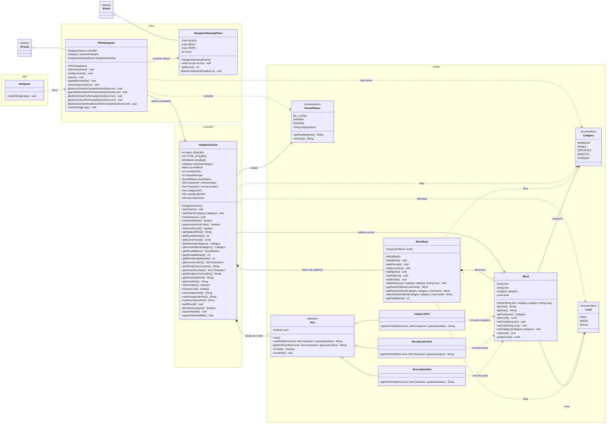

# Diagrama de clases UML — implementación en main

Diagrama Mermaid elaborado a partir de las fuentes Java de la rama `main` (15 de noviembre de 2026). Representa los paquetes `com.poo.hangman`, `controller`, `model` y `view`, sus clases, operaciones principales y relaciones. El diagrama puede editarse como texto y GitHub lo representa automáticamente.

## Notas de diseño

- `Hangman` inicia la interfaz Swing `POOHangman`.
- `POOHangman` hereda de `JFrame`, utiliza `HangmanGame` y contiene `HangmanDrawingPanel`. Se muestran los principales eventos y métodos propios; se omiten los numerosos campos de componentes generados por NetBeans para facilitar la lectura.
- `HangmanDrawingPanel` hereda de `JPanel` y sobrescribe `paintComponent(Graphics)` para dibujar las siete partes del ahorcado.
- `HangmanGame` administra tres rondas, siete errores máximos, las letras acertadas o fallidas, los estados y las tres pistas; `getClueWord()` consulta la descripción de la palabra.
- `Hint` es una superclase abstracta; `CategoryHint`, `RevealLetterHint` y `DescriptionHint` especializan `getHintText()`. Cada pista controla su uso mediante `isUsed()` y `resetHint()`.
- `WorkBank` conserva su nombre real (con **k**), carga palabras y proporciona las dos sobrecargas de `getRandomWord()`. Su selector privado es `selectRandomWord()`.
- `Word` almacena texto, categoría, descripción y nivel. `Category`, `Level` y `RoundStatus` son enumeraciones.
- La multiplicidad de `Hint` representa las tres referencias de tipo `Hint` declaradas en `HangmanGame`, no tres objetos de la misma subclase.
- Las clases de pruebas JUnit no se incluyen en el diagrama de clases de producción; permanecen en `src/test/java`.

El archivo histórico `hangman/src/main/java/docs/class-diagram.png` no fue modificado. Esta versión Mermaid es la referencia vigente.
